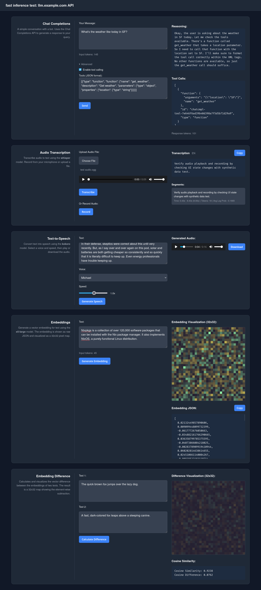

# litellm-landing

A dependency-free browser test bench for an OpenAI-compatible endpoint. Each page is a single
self-contained HTML file -- no build step, no framework, no bundler. Point it at any server that
speaks the OpenAI API (LiteLLM, vLLM, llama.cpp, Ollama, OpenAI itself) and exercise it from the
browser.



## Pages

| Path | What it exercises |
| --- | --- |
| `/` | Chat completions with token usage, tool calling, and reasoning output; TTS; embeddings with a 32x32 visual map; embedding-difference and cosine similarity |
| `/voice/` | Recording or uploading audio and transcribing it |
| `/realtime/` | Realtime voice chat over a WebSocket |
| `/ocr/` | Live OCR from an uploaded image |
| `/read/` | Long-form text reader driven by TTS |
| `/redact/` | PII detection and redaction |

## Running it

```
npm install        # only needed for the puppeteer-based voice test
node serve.js
```

Then open <http://localhost:8888/>.

`serve.js` is a ~130-line static file server that also reverse-proxies API calls, so the pages can
use same-origin relative paths (`/v1/...`) everywhere and you avoid CORS entirely. Configure it
with environment variables:

| Variable | Default | Purpose |
| --- | --- | --- |
| `PORT` | `8888` | Local listen port |
| `API_HOST` | `llm.example.com` | HTTPS host that `/v1/*` is proxied to |
| `REDACT_HOST` | `127.0.0.1` | Host for the PII redaction service |
| `REDACT_PORT` | `1327` | Port for the PII redaction service |

So to point the whole thing at your own endpoint:

```
API_HOST=your-endpoint.example.com node serve.js
```

In production the same routing is applied by nginx in front of the static files, which is why the
page JavaScript never contains a hostname.

The `/redact/` page expects a separate PII service exposing `/v1/pii` (the pages were built against
[speaches-plus](https://github.com/eordano/speaches-plus)); the other pages need only the
OpenAI-compatible endpoint.

## Models

The pages default to the models the reference deployment happens to serve -- `qwen3-8b` for chat,
faster-whisper distil-large-v3 for transcription, Kokoro-82M for speech, multilingual e5-large for
embeddings, dots.ocr for OCR. Where a page can enumerate `/v1/models` it offers a dropdown; the
rest are easy to change by editing the model name in the HTML.

## Tests

```
npm run test:voice
```

Drives `/voice/` with puppeteer-core against a running `serve.js`. Override the target with
`TEST_URL`.

## Provenance

The original single-file page was generated from this prompt, kept here because it documents the
intent better than a changelog would:

> I'd like you to create a very, very simple HTML+JS+CSS all in one file, that has a modern look
> and feel and dark mode according to user preferences, to check and test the current functioning
> of an OpenAI-compatible web server.
>
> The simple page should have:
>
> - Only about ~60px tall dedicated to a title describing what this is.
> - Use some sort of grid layout to have three columns: one with an explainer (right-text-aligned,
>   with a title in bold, and a subtitle); one with the input (generally text box), one with the
>   output generated.
> - First test is a simple conversation with a bot, using the Chat Completions API. It displays
>   token usage (input and response tokens) and supports advanced features including tool calling
>   with custom JSON tool definitions. It can display reasoning content, tool calls, and function
>   calls when the model returns them.
> - Second test is a simple voice transcribing. The test allows users to either upload an audio
>   file or record directly from their microphone. When recording, it automatically transcribes
>   after stopping. The transcription can be copied to clipboard.
> - Third test is a simple text-to-speech. Allow the user to select a voice and a speed, from
>   0.25x to 4.0x. Generated audio can be played directly and downloaded.
> - Fourth test is an embeddings service. Provide the answer as a JSON array of numbers, but also
>   generate a grid of 32x32 pixels that encode the values of the embedding, with configurable
>   points. The visualization includes an interactive tooltip showing the exact value and index
>   when hovering over pixels. Token usage is displayed.
> - Fifth: a vector-embedding difference test. Allows the user to enter two texts and shows a
>   similar "visual map" as above, but this time with the differences between the two (because the
>   difference can range from -2 to +2 instead of -1 to +1, divide it by two). The test also
>   calculates and displays the cosine similarity and cosine difference between the two
>   embeddings.

## License

MIT -- see [LICENSE](./LICENSE).
